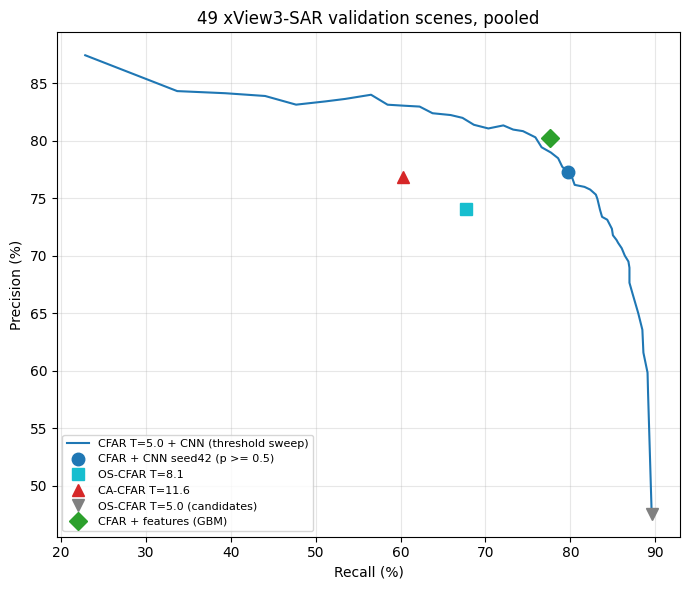

# Two-stage detection: CFAR candidates + CNN classifier

This folder tests whether a second stage improves on the best single-stage CFAR detector of the [49-scene benchmark](../benchmark/README.md). It uses the same 49 xView3-SAR validation scenes and the same scoring rules.

1. **Stage 1:** Hollow OS-CFAR at a low threshold (T = 5.0 dB) proposes candidates. On the 49 scenes it finds 89.6% of the evaluated vessels, with 1,621 false alarms.
2. **Stage 2:** a small CNN looks at a 64 × 64 pixel (640 m × 640 m) VH + VV chip around each candidate and keeps it if the predicted vessel probability is at least 0.5.

The method, decision rule and success criterion were fixed in [`PLAN.md`](PLAN.md) before any chip was extracted. A few details and secondary analyses were added after chip extraction but before any model was trained. That section of the plan lists what was known at the time. Deviations: none.

## Main result

**The two-stage system beats the best single-stage detector: pooled F1 78.5% vs 70.7%, a difference of +7.8 points (95% paired scene-level bootstrap interval +4.8 to +10.5).** The pre-registered criterion was that this interval excludes 0, and it does.

### Pooled over 49 scenes: all evaluated vessels (N = 1,642)

| System | TP | FP | FN | Precision (95% CI) | Recall (95% CI) | F1 |
|---|---|---|---|---|---|---|
| Hollow OS-CFAR, T = 8.1 (best single stage) | 1,111 | 390 | 531 | 74.0% (71.7-76.2) | 67.7% (65.4-69.9) | 70.7% |
| 2D CA-CFAR, T = 11.6 | 990 | 298 | 652 | 76.9% (74.5-79.1) | 60.3% (57.9-62.6) | 67.6% |
| Hollow OS-CFAR, T = 5.0 (stage 1 alone) | 1,471 | 1,621 | 171 | 47.6% (45.8-49.3) | 89.6% (88.0-91.0) | 62.1% |
| **CFAR T = 5.0 + CNN (p ≥ 0.5)** | **1,309** | **385** | **333** | **77.3% (75.2-79.2)** | **79.7% (77.7-81.6)** | **78.5%** |

Compared with OS-CFAR at T = 8.1, the two-stage system finds 198 more vessels with 5 fewer false alarms.

### Pooled over 49 scenes: HIGH-confidence labels only (N = 856)

| System | TP | FP | FN | Precision (95% CI) | Recall (95% CI) | F1 |
|---|---|---|---|---|---|---|
| Hollow OS-CFAR, T = 8.1 | 765 | 352 | 91 | 68.5% (65.7-71.1) | 89.4% (87.1-91.3) | 77.5% |
| 2D CA-CFAR, T = 11.6 | 727 | 277 | 129 | 72.4% (69.6-75.1) | 84.9% (82.4-87.2) | 78.2% |
| CFAR T = 5.0 + CNN | 810 | 369 | 46 | 68.7% (66.0-71.3) | 94.6% (92.9-95.9) | 79.6% |

The baselines were recomputed in the same run from the scene cache. Their per-scene counts are identical to the benchmark on all 49 scenes.

## Recall by label source

xView3 labels come either from AIS matched to the radar image and checked by an analyst (`ais/manual`), or from an analyst alone, with no AIS match (`manual`). `manual` vessels are the closest proxy for "dark" vessels in this dataset.

| System | `ais/manual` (N = 874) | `manual` (N = 765) |
|---|---|---|
| 2D CA-CFAR, T = 11.6 | 82.4% (79.7-84.8) | 35.3% (32.0-38.7) |
| Hollow OS-CFAR, T = 8.1 | 85.9% (83.5-88.1) | 46.8% (43.3-50.3) |
| **CFAR T = 5.0 + CNN** | **92.8% (90.9-94.3)** | **64.8% (61.4-68.1)** |
| Stage 1 alone (ceiling) | 96.1% (94.6-97.2) | 82.1% (79.2-84.6) |

Most of the gain is on the `manual` vessels: recall rises by 18 points. A single fixed threshold misses more than half of them. The low stage-1 threshold catches most of them, and the second stage removes most of the extra false alarms. Three vessels are labelled from AIS alone and are not shown.

## Secondary results

| Analysis | Precision | Recall | F1 | F1 difference to OS-CFAR T = 8.1 (95% CI) |
|---|---|---|---|---|
| CNN, seed 42 (primary) | 77.3% | 79.7% | 78.5% | +7.8 (+4.8 to +10.5) |
| CNN, seeds 1 to 5 | | | 77.1% to 79.4% | +6.4 to +8.7 (mean of all six seeds +7.7, sd 0.9) |
| Hand-crafted features + gradient boosting | 80.2% | 77.6% | 78.9% | +8.2 (+5.4 to +11.0) |
| CNN + non-maximum suppression (20 px) | 81.8% | 76.9% | 79.3% | +8.6 (+5.7 to +11.5) |

- **The result does not depend on the random seed.** Every seed's interval is above 0.
- **A simple feature model does as well as the CNN.** Gradient-boosted trees on 11 hand-crafted chip features match the CNN: the CNN minus the feature model is −0.4 F1 points (95% CI −2.5 to +1.4). The features are VH and VV peak and core mean, ring background, contrast, VH minus VV, and a bright-pixel count. So the gain comes from the two-stage design, a low threshold followed by a second-stage classifier, not from deep learning. With 64 × 64 chips and about 2,900 training labels, the CNN does not learn more than brightness, contrast and polarisation cues.
- **Merging duplicate candidates trades recall for precision.** Keeping only the most likely candidate within 20 px removes 105 false alarms but also 47 correct detections, because nearby vessels or the wrong fragment get suppressed. F1 changes little.
- **Threshold sweep:** the CNN threshold with the best F1 is 0.40 (F1 79.0%), almost the same as the pre-registered 0.5. This value is optimistic, because it was chosen on the test predictions.

The blue curve sweeps the CNN threshold. At the recall of OS-CFAR T = 8.1 (67.7%), the two-stage system has a precision of about 81% instead of 74%.

## Method in brief

- **Chips:** one 64 × 64 chip per candidate, VH and VV in dB from the unfiltered images, clipped to [−35, 5] dB and scaled to [0, 1].
- **Labels:** from the benchmark matching (Hungarian, 20 px). 1,471 positives, 1,447 negatives and 1,658 excluded from training. Excluded candidates lie near labelled non-vessels or unknown objects, or are a second fragment next to a vessel. All candidates, including excluded ones, are classified and scored at test time.
- **Split:** 5-fold cross-validation grouped by scene. No scene is in both training and test. Every candidate gets exactly one prediction from a model that never saw its scene.
- **Model:** 4 × [conv 3 × 3, batch norm, ReLU, max pool], with 32/64/128/128 filters, global average pooling, dropout 0.3 (0.24 M parameters). Weighted binary cross-entropy, Adam at 1e-3, batch 64, early stopping on a held-out training fold (12 to 24 epochs), and flip and rotation augmentation. No hyperparameter search.
- **Scoring:** the benchmark's evaluation function, per scene, pooled over scenes. Confidence intervals: Wilson for precision and recall, and a paired scene-level bootstrap (1,000 resamples) for F1 differences.

## Limitations

- **Same 49 scenes as the benchmark.** The stage-1 detector (OS-CFAR, not CA-CFAR) was chosen after seeing both on these scenes, which is a mild use of test-set information (see `PLAN.md`). The CNN itself is always tested on scenes it was not trained on.
- **The windows are those of the benchmark.** 46% of labelled vessels fall on cells of the dataset's coarse water mask marked as land and are not evaluated. Near-shore performance is therefore not measured.
- **Label noise.** Some "false alarms" are probably real but unlabelled vessels. This affects all systems alike, but it caps the measured precision.
- **Bright targets saturate in the chips** (clip at 5 dB). This was kept because very bright targets are rarely false alarms.
- **The recall ceiling is the candidate generator.** 10.4% of vessels, and 17.9% of `manual` vessels, are never proposed by stage 1, so no classifier can recover them.

## Files

| File | Content |
|---|---|
| [`PLAN.md`](PLAN.md) | Pre-registered plan, additions before training, deviations |
| [`build_cache_and_chips.ipynb`](build_cache_and_chips.ipynb) | Downloads each validation scene once, caches the benchmark window in Google Drive, extracts candidates, chips and labels |
| [`train_eval.ipynb`](train_eval.ipynb) | Cross-validated training, scoring, bootstrap and secondary analyses (with outputs) |
| [`results/cnn_pr_curve.png`](results/cnn_pr_curve.png) | Precision-recall figure above |

## Reproduce

1. Run `build_cache_and_chips.ipynb` with a fresh `validation.txt` (signed download links from the xView3 site) and `validation.csv`. It takes about 3.5 hours (50 scenes at about 4 minutes each) and needs about 5.3 GB of Google Drive space.
2. Run `train_eval.ipynb` on a GPU runtime. It needs only `validation.csv` and the Drive folder. It takes about 30 minutes on a Colab T4 with High-RAM: 22 minutes for the baselines and about 4 minutes of CNN training for six seeds.
